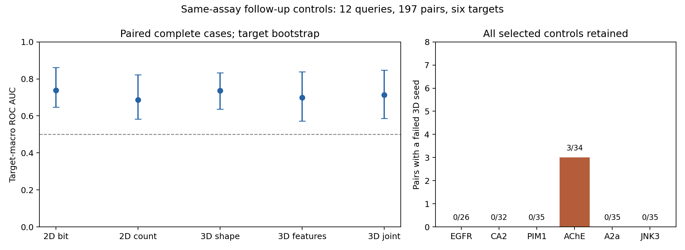

# Same-assay control evaluation — 2026-10-16

These retrospective controls compare similarity scores within a shared assay context. They do **not** demonstrate that the current 3D score outperforms 2D similarity, that generated molecules retain activity, or that proposed reactions succeed experimentally.

## Design and data

This follow-up was designed after the earlier [assay heterogeneity findings](../research-validation-20261016/assay_heterogeneity.json). The [selection/scoring plan](assessment_plan.json) was fixed before calculating these chemical scores. It is not an untouched confirmatory cohort or a replacement for the frozen generation comparisons. No scoring weights or thresholds were tuned on these results.

The source is the same bounded ChEMBL 37 collection: 15,533 retained measurements, grouped into 5,890 context–chemical-family records. A context is the exact assay ID, target ID, endpoint and units. Conflicting labels exclude a family only within its context; contradictory labels in another assay remain separate. Active means ≤1,000 nM and inactive ≥10,000 nM, with censoring respected. The source sampling, structured human-assignment policy and chemical scope remain as documented in the [curation protocol](../../../docs/ASSAY_MATCHED_CONTROLS.md).

Seed-42 hash selection retained two contexts per target and one active query per context. Every query has at least five active and five inactive control families, each different from both its family and scaffold, with at most ten controls per label and at least one different active reference scaffold. Selection used identifiers rather than similarity or potency magnitude.

The resulting panel contains **12 queries, 12 assays, six targets and 197 query–control pairs**. There are 111 active and 86 inactive controls, representing 197 distinct exact structures and chemical families; the 12 query families are distinct and do not overlap those controls. These counts do not create 197 independent target replicates. Caps are maxima, so the panel was not padded to 240 pairs.

Shared assay ID improves context matching but does not verify identical conditions for every observation. Four selected assay descriptions still contain “unknown origin”; two contexts have cell-based BAO annotations, and one has a cell-membrane annotation. These metadata are retained in [analysis.json](analysis.json), without inferring biological truth from prose. Structured human assignment and null variant annotations are not proof of human wild-type constructs or a uniform biochemical experiment.

## Results

The fixed scoring protocol uses eight requested conformers, seeds 42/43/44, the same energy/strain/feature settings as the original controls, and rejection of unspecified stereochemistry. A 3D score is the median only when all three seeds succeed. **194/197 pairs completed 3D scoring**; three AChE pairs failed the stereo policy, producing nine failed seed trials. No unexpected scorer errors occurred.

| Score | Paired complete-case ROC AUC | 95% target-bootstrap interval |
| --- | ---: | ---: |
| Bit Morgan Tanimoto | 0.7392 | 0.6466–0.8617 |
| Count Morgan Tanimoto | 0.6870 | 0.5824–0.8221 |
| 3D shape | 0.7370 | 0.6361–0.8328 |
| 3D pharmacophore | 0.6994 | 0.5725–0.8392 |
| Joint 3D | 0.7131 | 0.5864–0.8469 |

The joint-3D minus bit-Tanimoto ROC difference is −0.0261, with a paired target-bootstrap interval of −0.1017 to +0.0402. This does not establish an advantage for 3D. Across all controls, bit-Tanimoto ROC is 0.7358; the table restricts it to the same successful cases as 3D. Joint-score all-control missing-score bounds are **0.6847–0.7230**. These are identification bounds, not confidence intervals. Higher discrimination than in another panel cannot be attributed to assay matching alone because the evaluated compounds and queries changed.

Per-query ROC AUC and average precision were independently recomputed with scikit-learn, including extreme assignments for every missing score. Estimates average queries within context, contexts within assay, assays within target and finally targets equally. All query/context/assay/target estimates and bounds agreed with the framework within `1e-12`. Bootstrap intervals use 10,000 resamples of target means, seed 20261016. The same six source targets recur in the earlier panels; shared chemistry and related biology can also correlate target groups. Label-capped controls do not represent deployment prevalence.



The [PDF figure](controls.pdf) is exportable. Full ROC/AP estimates, paired comparisons, denominators, source descriptions and failures remain in the adjacent JSON files. These similarities are not calibrated activity probabilities.

## Reproduction

Recompute every reported statistic and figure directly from the bundled scores, using the repository environment plus [analysis requirements](analysis-requirements.txt):

```bash
python benchmarks/results/assay-matched-controls-20261016/analyze.py \
  --input benchmarks/results/assay-matched-controls-20261016 \
  --output benchmark-results/recomputed-assay-matched-analysis
```

The portable script reproduces the recorded numerical report exactly. To reconstruct observations and calculate chemistry again, extract the [retained source ZIP](../research-validation-20261016/chembl-source-snapshot.zip) and follow the audit/select commands in the [same-assay protocol](../../../docs/ASSAY_MATCHED_CONTROLS.md), using the fixed policy above. Use the freshly reconstructed panel so source paths resolve on the new machine. Original JSON hashes include local paths and can differ after relocation; scoped records, labels, selected pairs and scoring settings are the reproducibility targets.

The [source round trip](source_roundtrip.json) rebuilt all 5,890 curated records and all exclusions from that ZIP, then reproduced the selected panel, 197 pairs and 12 public queries. Every pre-existing availability field matched. The final curator additionally emits six minimum-five-controls/one-active-scaffold summary counts; these were independently recomputed from the original per-query availability and matched. This additive metadata difference is recorded rather than described as byte-identical reproduction.

The original chemical scores used the scoring implementation present at commit `3c8ad2b619d8168e061d63467b6b9391e2464d2d`; [protocol.json](protocol.json) pins individual source hashes and settings. [input_audit.json](input_audit.json) records independent source-payload validation and deterministic selection reproduction. [validation.json](validation.json) records the 403-test integration check.

The later optimization at `53709051` reuses an alignment only when the two references are the same ensemble object. An independent check on the first selected control of each of these 12 queries found exactly identical score/diagnostic dictionaries and coordinates, with half as many overlay calls. Its full regression suite passed 411 tests. [overlay_reuse_validation.json](overlay_reuse_validation.json) retains the individual checks and diagnostic timings; shared-host warm-scoring timings are not a general generation-throughput claim. The recorded control scores and running generation comparisons keep their original implementation and observations.

`scores.json` keeps every selected pair and seed trial. Row `status: success` means the scoring function returned; `all_3d_seeds_succeeded`, missing 3D metrics and the trials determine 3D completeness. Thus a 3D failure preserves independently available 2D scores. `framework-summary.json` uses each metric's available observations, while `framework-paired-summary.json` uses the shared complete cases. Both keep all selected pairs in missing-score bounds.

ChEMBL-derived records and adaptations are attributed to [EMBL-EBI ChEMBL](https://www.ebi.ac.uk/chembl/) under [CC BY-SA 3.0](https://creativecommons.org/licenses/by-sa/3.0/). Adaptations include filtering, context/family grouping, deterministic control selection and computed scores. The data license does not change the repository's code license. Source URLs and SHA-256 values remain in `panel.json`; the raw archive is shared with the earlier control report.
