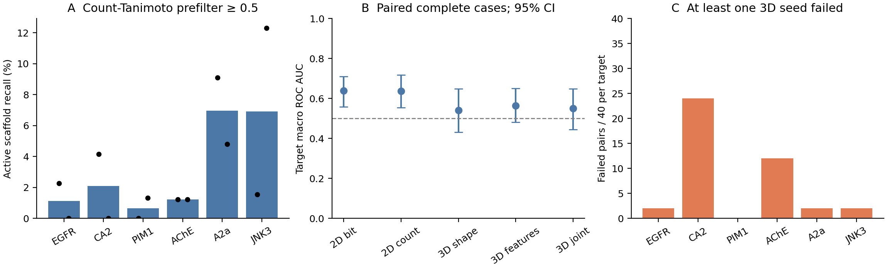
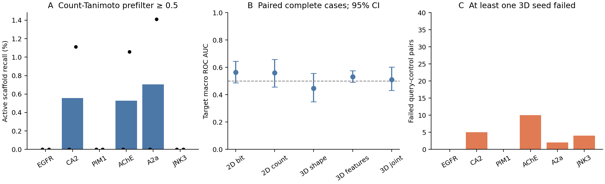
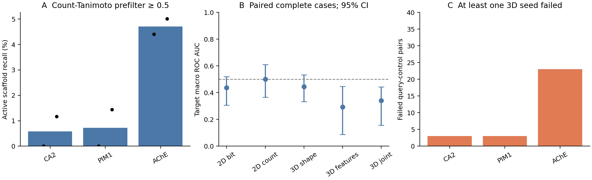

# Recorded control evaluation — 2026-10-16

These records assess similarity discrimination and prefilter loss on retrospective labelled controls. They do not establish improved generation, biological activity of new molecules, or experimental synthesizability. At this record, the 360-run main generation comparison was in progress and 270 secondary runs were queued.

## Scope and provenance

The strict scaffold panel contains 5,567 target–chemical-family records, with two public queries for each of EGFR (CHEMBL203), CA2 (CHEMBL205), PIM1 (CHEMBL2147), AChE (CHEMBL220), A2a (CHEMBL251) and JNK3 (CHEMBL2637). Its SHA-256 is `e87a3b539b8c41dde4887a7d52ec67b29a7a63f688584b579272398ef6522204`. Scaffold assignment uses seed 42 and the versioned chemical-family policy in the [protocol](../../../docs/RESEARCH_VALIDATION.md).

Source data are from EMBL-EBI [ChEMBL](https://www.ebi.ac.uk/chembl/), release 37, retained on 2026-10-15. The bounded acquisition selected at most the first 1,000 activity IDs per target and publication-year band (≤2010, 2011–2020, >2020); it is not a complete target inventory or a random population sample. ChEMBL-derived records and adaptations retain [CC BY-SA 3.0 attribution](https://creativecommons.org/licenses/by-sa/3.0/); this data license does not change the repository's code license. Changes comprise assay filtering, chemical-family grouping, label assignment, partitioning and computed similarity summaries. See the [ChEMBL database citation](https://doi.org/10.1093/nar/gkad1004) and [41-source URL/hash manifest](source_provenance.json).

Included measurements require direct human binding-assay metadata: confidence 9, relationship D, exact target assignment, *Homo sapiens* assay organism and an explicitly null variant-sequence annotation. These metadata checks do not prove wild-type constructs or comparable experimental conditions. IC50 is used for EGFR/PIM1/AChE/JNK3; Ki for CA2/A2a. Active means ≤1,000 nM and inactive ≥10,000 nM, respecting censoring; conflicting and ambiguous labels are excluded. Assays are still heterogeneous. Inputs are connected molecules with at most 60 heavy atoms.

The control sample contains **240 query–control pairs, representing 120 compound IDs and 119 distinct exact structures**: 10 active and 10 inactive controls per query, deterministically selected with seed 42 from held-out families with a different scaffold from the query. The same compounds recur across a target's two queries. There are no decoys in this record. Balanced capped sampling does not reproduce deployment prevalence.

## Results and analysis

Full-population recall counts a held-out active scaffold as surviving when at least one member passes count Tanimoto ≥0.5. This uses every eligible active reference before control subsampling. Mean recall across queries within each target, then equally across six targets, was **0.0316201**; the independent target-bootstrap 95% interval was **0.0114856–0.0518026**.

| Score | ROC AUC on the same complete cases |
| --- | ---: |
| Bit Morgan Tanimoto | 0.6389815 |
| Count Morgan Tanimoto | 0.6365741 |
| 3D shape | 0.5415741 |
| 3D pharmacophore | 0.5639815 |
| Joint 3D | 0.5500000 |

The 3D protocol requests eight conformers per seed (42, 43, 44), 500 optimization iterations, energy window 5, pharmacophore sigma 1 and strain penalty 0.05; unspecified stereochemistry is rejected. Query conformers are generated; no bound pose or receptor is supplied. Scores are seed medians only when all three seeds succeed. Shape, pharmacophore and joint scores therefore share the same complete cases.

**42/240 pairs failed**, all with the specified-stereochemistry policy reason, producing 126 failed seed trials. Complete-case comparisons use the remaining 198 pairs across 11 queries. CA2 query 2 has no complete cases; its cage-stereo flag is retained in [query_scope.json](query_scope.json), and its 20 failed pairs remain in failure totals and all-control bounds. Within-target complete-case averages use available query estimates, so the CA2 estimate uses one query. Complete-case selection can bias discrimination estimates.

ROC AUC and average precision are recomputed per query with scikit-learn, then averaged within target and equally across targets. All recomputed ROC/AP estimates and missing-score bounds matched the framework within `1e-12`. Bootstrap intervals use 10,000 resamples of the six target means, seed 20261016; compounds and seeds are not treated as independent target replicates. The interval above comes from [control_analysis.json](control_analysis.json); the original controls summary uses a different bootstrap draw configuration and has slightly different endpoints.

Missing-score bounds assign failed active controls below every observed score and failed inactive controls above them, then reverse those assignments for the upper bound. The joint 3D all-control ROC interval is **0.3858333–0.6441667**. These are identification bounds, not confidence intervals. The record does not support a claim that 3D scoring improves discrimination; none of these similarities is a calibrated activity probability.



Figure: (A) Count-Tanimoto ≥0.5 active-scaffold recall over all eligible held-out actives; bars are target means and points are the two queries. (B) Target-macro ROC AUC on paired complete cases with 95% target-bootstrap intervals; the dashed line marks 0.5. (C) Pairs with at least one failed 3D seed, out of 40 per target. All recorded failures are stereo-policy rejections. [PDF figure](controls.pdf).

## Reproduction and files

### Publication-year and held-out-target controls

The same scoring and sampling protocol was also evaluated on the frozen publication-year partition (cutoff 2020) and target partition. These are alternative partitions of the same bounded source collection, not independent external cohorts. The target partition evaluates CA2, PIM1 and AChE; EGFR, A2a and JNK3 form its development library. No similarity score was fitted to these labels. Target separation alone does not establish unseen pretrained-model chemistry.

| Partition | Targets / queries | Pairs / failed 3D pairs | Active-scaffold recall at count T ≥0.5 | Paired bit ROC AUC | Paired joint 3D ROC AUC |
| --- | ---: | ---: | ---: | ---: | ---: |
| Scaffold | 6 / 12 | 240 / 42 | 3.162% | 0.6390 | 0.5500 |
| Publication year | 6 / 12 | 240 / 21 | 0.298% | 0.5638 | 0.5104 |
| Held-out target | 3 / 6 | 120 / 29 | 2.005% | 0.4377 | 0.3401 |

The time controls represent 130 distinct compound IDs and exact structures; target controls represent 99. All additional 3D failures are explicit stereo-policy rejections. Independent ROC/AP and missing-score-bound calculations agreed with the framework within `1e-12`. Joint-score all-control ROC bounds are 0.4300–0.5950 for time and 0.2217–0.5367 for target. Target-bootstrap intervals and every metric appear in [secondary_controls.json](secondary_controls.json), [time analysis](time_control_analysis.json) and [target analysis](target_control_analysis.json). Three target groups provide limited uncertainty information. These results do not demonstrate improved discrimination from the current 3D score, and they retain the assay heterogeneity described below.





The [secondary relocation audit](secondary_panels_roundtrip.json) reconstructed both panels from the bundled ZIP: all 5,575 time-panel and 5,557 target-panel records, supporting assay metadata, queries, partitions and source URL/hash entries matched. Portable analysis also reproduced every numerical estimate. After extracting the source archive as below, reproduce either partition by replacing `scaffold` with `time` or `target` in the panel import command (`--cutoff-year 2020` is the time default), then run the same controls command on that panel. Reanalyse the bundled score records directly with:

```bash
python benchmarks/results/research-validation-20261016/analyze_secondary_controls.py \
  --scores benchmarks/results/research-validation-20261016/time_control_scores.json \
  --summary benchmarks/results/research-validation-20261016/time_control_summary.json \
  --output benchmark-results/recomputed-time-controls
```

Use the corresponding `target_control_*.json` paths for the target partition.

### Early validation of fixed 3D references

Commit `009b7aaa` validates a fixed query's 3D prerequisites before generation and model loading. Independent regression testing passed all 390 tests. An actual CA2 request with unspecified cage stereochemistry was rejected in 2.41 seconds, before a generator output directory was created; its original frozen run spent 156.26 seconds before returning no candidates. This single diagnostic establishes earlier rejection under the same policy, not a general throughput improvement. [preflight_validation.json](preflight_validation.json) records the request hash and check results. The running generation comparisons keep their original code and timing observations.

### Design reference preflight

Commit `08c3774c` checks the original capped design references before synthesis work. Invalid references are reported individually, without assigning missing stereochemistry or backfilling the cap. Valid alternatives retain their order, provider seeds and scoring behavior. When all capped designs fail, unused catalog/model/pocket assets are not initialized or validated; their unavailable hashes and explicit rejection reasons are retained.

Independent testing in an isolated CPU environment passed **464 tests**, with one optional `oddt` test skipped. Replaying a retained PIM1 input confirmed that its hit passes the existing policy and both capped designs fail it. Catalog, model, route-verification and embedding spies all recorded zero calls; the explicit empty result was produced in 3.81 seconds. This is a diagnostic replay with forbidden-call spies, not a general timing comparison or a replacement for the original generation attempt. [design_preflight_validation.json](design_preflight_validation.json) records input/code hashes, checks and limitations. All 39 frozen campaign source files remain unchanged.

### Graceful benchmark termination

Commit `1afac243e629dcb7e3b967814d0c07913d162c0b` handles SIGTERM/SIGINT by stopping the active worker's process group, preserving sampled resources, checkpointing the interrupted attempt and preventing a subsequent attempt. A plausible partial response remains diagnostic and cannot become accepted output. A worker result already validated before cancellation remains valid. The CLI exits 143/130; library signal handlers are restored, and cancellation during setup/evaluation is cooperative at Python work boundaries. SIGKILL cannot provide the same checkpoint guarantee.

The independent full regression suite passed **452 tests**, including 16 signal cases. Actual subprocess tests exercised TERM-resistant grandchildren, repeated signals, unrelated-process preservation and cancellation at several boundaries. [runner_signal_validation.json](runner_signal_validation.json) records the implementation and test hashes. All 39 source files in the ongoing original generation campaign remain unchanged; these engineering checks do not replace or rewrite its outcomes.

### Explicit scoring-reference identities

Commit `d2090099` fixes a `scores.json` attribution bug: 3D metric expansion overwrote the design SMILES with its metric dictionary. Every 2D/3D screening and refined record now includes explicit `hit_smiles` and `design_smiles`, while retaining existing metrics. In six bounded before/after subruns using 19 actual building blocks and two designs, all 13 score records changed only by those fields; 23 table, route, refinement and SDF artifact pairs were byte-identical. Three new regressions passed independently; the earlier 488-test result was not rerun after this fix. A separate audit of the 2026-10-15 19:28:54 UTC campaign snapshot checked 14 successful runs, 39 returned candidate records and 72 final seed trials, with 1,269 arithmetic/statistical checks passing. Legacy 3D design attribution was recovered from route metadata. The [validation record](score_reference_validation.json) distinguishes direct 2D and arithmetic checks from pharmacophore roundtrips using the project function; it does not independently validate the shape kernel, global alignment optimality or method superiority. Private molecules are excluded, and frozen source files and outputs remain unchanged.

### Later fixed-pose score check

The [later direct-point validation](fixed_pose_score_validation.json), completed at **2026-10-15 19:51:22 UTC**, extends the earlier export check without rewriting it. On the same 19:28:54 snapshot, nine successful 3D runs supplied 24 returned candidate records and 48 reference/pose pairs. Direct [RDKit `ScoreMol`](https://www.rdkit.org/docs/source/rdkit.Chem.rdShapeAlign.html) calls used `normalize=False` and `useColors=True` without realignment. Separate pharmacophore arithmetic used NetworkX matching and covariance eigenvectors, importing no project scorer. All 288 score checks, 96 feature-count checks and 96 unchanged-coordinate checks passed. Maximum absolute shape/color/pharmacophore/joint errors were **5.56e-6 / 1.46e-5 / 8.44e-6 / 6.40e-6**, within the 1e-4 SDF tolerance. One-pair controls checked self-scores, 100 Å separation and common rigid motion. RDKit's shape/color kernel and chemical feature perception remain shared, so this is not a wholly independent kernel or chemistry validation, nor evidence of global alignment optimality, activity or method superiority. The tested runtime was RDKit 2025.09.6; the linked API documentation is live. This covers the retained successful outputs, not all campaign results or a full-suite rerun; hash-bound local evidence is not a self-contained public replay.

### Lazy catalog fingerprints

Commit `ddecd995` defers each catalog fingerprint until first access while preserving eager validation of the full input and provenance. `fps` is now a mutable mapping rather than a concrete dictionary; it captures the original fingerprint generator and caches values per catalog. A single pre-change profile of 238,542 rows attributed 8.189 of 89.294 CPU seconds (**9.17%**) to fingerprints; wall time included low-priority scheduling. This is not a measured post-change speedup or memory reduction. Independent checks on 795 real catalog rows reproduced every fingerprint bit, 16 route-verification outputs and 200 nearest-search results. Constructor fingerprint calls fell from 795 to zero, with zero through route replay. The independent CPU regression suite passed **488 tests**, with one optional `oddt` skip. The [validation record](catalog_lazy_fingerprint_validation.json) pins commits, reports and scripts and distinguishes the sampled checks from full-catalog equivalence. Private catalog rows/routes are not bundled. The original 630-attempt campaigns retain their frozen code and observations.

### Common forward audit: engineering validation

The [CPU validation record](forward_audit_validation.json) covers isolated dependency checks, two selected inference compatibility probes, fresh replay of 61 retained route cache entries without repeat model inference, and independent source/response/statistical checks. Targeted suites passed 50 analysis-helper tests and 19 queue tests. The two probes do not establish held-out accuracy or general CPU/GPU equivalence. Its pending CUDA-environment status describes its **2026-10-15 18:55:02 UTC** timestamp; that historical report remains unchanged. The forward predictor is also used by the synthesis selection gate, so selection-related enrichment is expected and is not independent experimental synthesis evidence. The [post hoc analysis plan](forward_analysis_plan.json) was specified before comparative analysis but is not preregistered. The final **630-attempt comparison remains pending**, gated on the complete planned grid and matching provenance; these engineering results do not establish method superiority, activity or synthesis success. The frozen campaign sources and original observations remain unchanged.

The later [isolated runtime validation](isolated_runtime_validation.json), independently checked at **19:38:46 UTC**, records that the original installer completed and all four recorded validation steps exited successfully. All 62 original pins matched; the 64 installed distributions also include editable Chembounce and setuptools 84.0.0, which was resolved during editable installation rather than originally pinned. The CUDA-enabled Torch 2.8.0/CUDA 12.8 and Triton 3.4.0 environment inherited no system site-packages and passed **359 frozen-code tests**, with one optional `oddt` skip, plus two selected ReactionT5 CPU probes matching retained predictions. These tests concern the frozen `d972124` scientific source, not current develop. **Actual GPU execution remains unassessed**; the ongoing campaigns keep their original environment.

### Partial training-sample audit

The [training-inventory evidence and audit](../training-inventory-audit-20261016/README.md) found no complete inventory tied to the exact SynLlama or ReactionT5 checkpoint. Against SynLlama's upstream train-labelled 1,000-molecule evaluation sample, the recorded evaluation snapshot had zero exact matches and zero matches to 928 assessable sample families; 72 sample families remained unassessed. Independent numerical recomputation passed for 19,387 appearances (5,618 exact structures, 5,616 families) across 14 sources. This snapshot includes only the 137 main-campaign runs recorded at 2026-10-15 18:27:40–41 UTC. The sample's membership in the exact checkpoint training corpus is unverified, and absent matches do not prove clean holdout; later outputs are outside this audit. The separate evidence report records public ZINC inventory availability without claiming its contents or exact base-checkpoint association were verified. Molecular sample/snapshot details remain excluded from the public bundle, which contains aggregates, provenance and the audit procedure.

### Existing scaffold search-space sample

The [scope disclosure](search_space_inventory_scope.json) summarizes the frozen primary manifest's existing search-space audit, separate from model-training exposure. It selected 5,000 of 848,180 raw scaffold-text records with seed 42: 4,755 were assessed and 245 remained unassessed because connected molecules without dummy atoms were required. All 188 matched dataset records had scaffold overlap: 102 test/active, 23 test/inactive, 39 train/active and 24 train/inactive. One train/inactive record also had chemical-family overlap; no query compound matched. These are compound-record counts across all partitions, not 188 distinct scaffolds or query-specific active-reference coverage. Exact-SMILES and generic-skeleton matches were not reported.

The actual generator searches the explicitly supplied fingerprint database and checks its declared text-source hash. Its SMILES array has 522,959 rows; metadata declares canonical sorted uniqueness, 39,862 rejected raw lines and RDKit 2026.09.1 construction. Those declarations are not an independent chemical-uniqueness check or source rebuild. The sampled text audit does not establish exhaustive coverage of this effective library. These are replacement scaffold/fragment templates; their presence does not itself establish active end-product retrieval or activity-label leakage. The record pins local manifest, panel, protocol, metadata and code evidence, which is not bundled. No new normalization, time/target estimates or generation results were added.

### Assay-context sensitivity

The later [assay-context audit](assay_heterogeneity.json) is explicitly post hoc. Of 5,567 records, 1,103 have a representative assay annotated as cell-based and 1,229 have representative descriptions containing “unknown origin” or “unspecified origin.” Across all retained supporting assays, 1,250 records have that origin ambiguity and 79 span multiple assay-format annotations. The text flags do not prove a non-human experiment; they expose unresolved ambiguity despite the structured human assignment. A null variant annotation is not experimental proof of wild-type sequence. ChEMBL's [confidence score concerns assay-to-target assignment](https://chembl.gitbook.io/chembl-interface-documentation/frequently-asked-questions/chembl-data-questions), not equivalent experimental conditions.

Requiring query and control to share a retained assay ID leaves six pairs, four with successful 3D scoring, and only one target with both active and inactive observations. That is insufficient for a general activity-discrimination claim. The audit also reports format-matched and single-protein-format sensitivity subsets, their missing scores and actual target counts. Those subsets change the evaluated population; their estimates cannot be treated as improvement over the original cohort or as confirmatory findings. Frozen panels, thresholds and generation settings were not changed in response to these results.

A subsequent [separately selected same-assay evaluation](../assay-matched-controls-20261016/README.md) contains 197 pairs across 12 queries/assays and the same six targets. It preserves the original controls and records its follow-up timing and fixed criteria. Its paired bit/joint-3D ROC AUCs are 0.7392/0.7131, without an established 3D advantage. Different evaluated populations prevent interpreting the difference from this original panel as an effect caused solely by assay matching.

### Recompute the records

From the repository root, use the recorded Python 3.10 environment, project synthesis dependencies and [pinned control requirements](control-requirements.txt). Reproduce the independent metric check, bootstrap and figures directly from the adjacent compact records:

```bash
python benchmarks/results/research-validation-20261016/analyze_controls.py \
  --output benchmark-results/recomputed-controls
```

To reconstruct the panel and recompute chemical scores, extract the [bundled raw ChEMBL snapshot](chembl-source-snapshot.zip), verify its hashes, and use new output directories:

```bash
python -m zipfile -e \
  benchmarks/results/research-validation-20261016/chembl-source-snapshot.zip \
  benchmark-results/reproduced-chembl-sources
python -m benchmarks.research.sources verify benchmark-results/reproduced-chembl-sources
python -m benchmarks.research.import_chembl \
  --manifest benchmark-results/reproduced-chembl-sources/00-chembl-manifest-with-assays/manifest.json \
  --output benchmark-results/reproduced-control-panel \
  --split scaffold --seed 42 --queries-per-target 2 \
  --active-nm 1000 --inactive-nm 10000 --max-heavy-atoms 60
python -m benchmarks.research.controls \
  --dataset benchmark-results/reproduced-control-panel/panel.json \
  --output benchmark-results/recomputed-control-scores \
  --conformers benchmarks/results/research-validation-20261016/common-conformers.json \
  --max-per-label 10 --seeds 42 43 44 --count-tanimoto-threshold 0.5
python benchmarks/results/research-validation-20261016/analyze_controls.py \
  --scores benchmark-results/recomputed-control-scores/control_scores.json \
  --summary benchmark-results/recomputed-control-scores/summary.json \
  --output benchmark-results/recomputed-chemical-analysis
```

The [conformer JSON](common-conformers.json) is exactly `control_summary.json["protocol"]["conformers"]`. Reconstructed panel paths differ from the original local paths, so its byte-level JSON hash can differ despite equivalent chemical records and partitions. [control_summary.json](control_summary.json) records the original dataset hash, local source paths, scoring protocol and full prefilter population; [control_scores.json](control_scores.json) preserves pair scores and seed failures. Original source URLs and per-source hashes are in the source manifests, not in the compact summary. [artifacts.json](artifacts.json) identifies artifact hashes; live source URLs do not guarantee the same bytes. [engineering.json](engineering.json) separately records software checks and environment limitations. The archive covers ChEMBL controls; it does not package all generation-model assets or establish an unseen pretraining inventory.

The [archive relocation check](snapshot_roundtrip.json) verified all 43 packaged artifacts and rebuilt the strict panel in a fresh location. All 5,567 biological records, 12 queries, split definitions and 41 original source URL/hash entries matched. The portable analysis script also reproduced the recorded numerical estimates exactly.

After the source extraction and panel reconstruction above, reproduce the assay audit with the adjacent [audit script](audit_assay_heterogeneity.py):

```bash
python benchmarks/results/research-validation-20261016/audit_assay_heterogeneity.py \
  --panel benchmark-results/reproduced-control-panel/panel.json \
  --manifest benchmark-results/reproduced-chembl-sources/00-chembl-manifest-with-assays/manifest.json \
  --output benchmark-results/recomputed-assay-heterogeneity.json
```

The default control scores are the bundled primary controls; use `--controls` to audit an explicitly recomputed score file. Path and script hashes can differ after relocation; assay counts, retained pair IDs and numerical summaries are the reproducibility targets.
